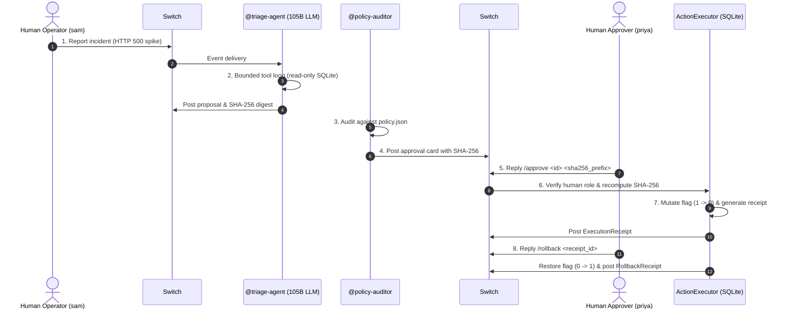

# SwitchGate Lite — AI Operations Approval & Rollback Airlock for Switch Rooms

**Track**: Best Business Workflow — [Flip the Switch Hackathon](https://www.wemakedevs.org/hackathons/switch)  
**Supported LLM Providers**: [Sarvam AI](https://www.sarvam.ai/) (`sarvam-105b-conversations`), [OpenAI](https://openai.com/) (`gpt-4o-mini`), [NVIDIA Build NIM](https://build.nvidia.com/) (`meta/llama-3.3-70b-instruct`)  
**Switch Stack**: Official [Switch AI](https://github.com/sandbox-quantum/switch) (`switch-core` + PostgreSQL 16 + Gateway Dashboard)

SwitchGate Lite is a human-gated AI operations workflow built for [Switch AI](https://github.com/sandbox-quantum/switch). It implements the [Switch Shared Responsibility Model](https://docs.switchagents.ai/switch-rooms/resources/shared-responsibility) by separating **read-only AI incident triage** from **human-approved, SHA-256-bound feature-flag execution and rollback**.

---

## 1. The Real-World Problem SwitchGate Solves

Autonomous AI agents in DevOps and SRE are dangerous when given unconstrained production write permissions. A single hallucinated parameter or hijacked prompt can disable critical services, drop tables, or trigger cascade outages.

Conversely, requiring humans to manually run diagnostic commands in terminals creates high Mean Time to Recovery (MTTR).

**SwitchGate Lite solves this dilemma with a "Sandwich Architecture"**:
1. **Top Layer (AI Triage & Audit)**: AI agents investigate incidents and draft proposals in shared Switch chat rooms, but operate under strict read-only constraints (`PRAGMA query_only = ON`).
2. **Middle Layer (Cryptographic Proposal Binding)**: Every proposed mutation is deterministically bound with an RFC 8785 canonical JSON SHA-256 digest (`proposal_sha256`).
3. **Bottom Layer (Deterministic Human-Gated Execution & Rollback)**: An air-gapped `ActionExecutor` blocks any mutation until an authorized human operator explicitly signs off in the Switch Room (`/approve <id> <sha256>`). The executor verifies identity and re-computes the hash to eliminate Time-of-Check to Time-of-Use (TOCTOU) tampering. If anything goes wrong, a 1-command rollback (`/rollback <receipt_id>`) restores the previous state byte-for-byte.

---

## 2. How We Use Switch (Why Switch Is Central)

Switch is the foundational communication backbone and privilege boundary of SwitchGate Lite:

1. **Declarative Multi-Room Airlock (`#incident-triage` & `#approval-vault`)**:
   - Defined in [`config/switchgate-lite.template.yaml`](config/switchgate-lite.template.yaml) using Switch Template v2 (`version: 2`, `resources:`, `roles:`, `docs:`, `agents:`, `rooms:`).
   - `#incident-triage`: A room for engineers and `@triage-agent` to report incidents, inspect error spikes, and draft rollback plans.
   - `#approval-vault`: An isolated room where `@policy-auditor` posts cryptographic approval cards, authorized human approvers sign off, and `@action-steward` posts execution receipts.
2. **Native Switch Protocol Integration**:
   - Registers agents dynamically via `POST /agents` using the Switch agent registration bootstrap token.
   - Publishes room events and messages via `POST /agents/{agent_id}/message`.
   - Reads conversation context and thread history via Switch's native `POST /agents/{agent_id}/ops/read_context`.
   - Provisions and maps rooms via Switch's `list_rooms` and `create_room` operations.

---

## 3. End-to-End 8-Step Room Workflow



---

## 4. Repository Structure

```text
switchgate-lite/
├── README.md                            # Comprehensive documentation and reproduction guide
├── DECISIONS.md                         # Architectural decisions and Document C tradeoffs
├── DEMO_AND_SUBMISSION.md               # 2-minute timed demo script and submission checklist
├── .env.example                         # Environment configuration template
├── config/
│   ├── policy.json                      # Policy rules, protected flags, and approver list
│   └── switchgate-lite.template.yaml    # Switch Template v2 multi-room agent definition
├── src/
│   ├── __init__.py
│   ├── models.py                        # Dataclasses, canonical RFC 8785 SHA-256 hashing
│   ├── sandbox_db.py                    # SQLite feature-flag sandbox & state digest engine
│   ├── tools.py                         # Read-only @tool JSON schemas for @triage-agent
│   ├── prompts.py                       # System prompts & JSON contracts for agents
│   ├── llm_client.py                    # Live LLM client (Sarvam / OpenAI / NVIDIA) & telemetry
│   ├── agents.py                        # TriageAgent (bounded loop) & PolicyAuditorAgent
│   ├── executor.py                      # Deterministic SHA-256 human-gated executor & rollback
│   ├── switch_bridge.py                 # Live Switch Room HTTP REST protocol bridge
│   ├── env_loader.py                    # Zero-dependency local environment loader
│   └── cli.py                           # CLI entrypoint (check-switch, check-llm, run-flow)
├── scripts/
│   └── verify_guardrails.py             # AST & line-count guardrail verifier (all files <= 250 lines)
└── tests/
    ├── test_switchgate_lite.py          # 6 automated unit & security regression tests
    └── test_live_integration.py        # 2 live integration tests against live Switch & LLM
```

---

## 5. Quickstart & Reproduction Instructions

### 1. Prerequisites
- Python 3.9+ (Zero third-party `pip` dependencies needed for the core engine)
- Docker & Docker Compose (for running local `switch-core` and PostgreSQL)

### 2. Start Live Switch Core Server
From the project workspace:
```bash
# Start official Switch Core + PostgreSQL
cd ../switch-server
docker compose up -d

# Verify Switch health
curl -s http://127.0.0.1:8000/health
# Response: {"status":"ok"}
```

### 3. Configure Environment Variables
Copy `.env.example` to `.env`:
```bash
cd ../switchgate-lite
cp .env.example .env
```
Ensure `.env` contains:
```ini
SWITCH_SERVER_URL=http://127.0.0.1:8000
AGENT_REGISTRATION_TOKEN=<your_token>
SARVAM_API_KEY=<your_key>
LLM_PROVIDER=sarvam
LLM_MODEL=sarvam-105b-conversations
```

### 4. Run Automated Unit & Guardrail Tests
```bash
cd switchgate-lite

# Run all 8 tests (6 unit tests + 2 live integration tests)
python3 -m unittest discover -s tests -v

# Run Document C AST & line-count guardrail verifier
python3 scripts/verify_guardrails.py
```

### 5. Verify Connections and Execute the 8-Step Flow
```bash
# 1. Verify live Switch Core connectivity
python3 -m src.cli check-switch

# 2. Verify live LLM inference
python3 -m src.cli check-llm

# 3. Execute the complete end-to-end flow with state rollback
python3 -m src.cli run-flow --reset-db --with-rollback
```

For interactive human approval in terminal:
```bash
python3 -m src.cli run-flow --reset-db --with-rollback --interactive-approval
```

---

## 6. Safety Boundaries & Governance Guarantees

1. **Read-Only SQLite Triage**: `@triage-agent` executes with `PRAGMA query_only = ON`. It is structurally incapable of writing to the database.
2. **Canonical SHA-256 Digest**: Action parameters are serialized into deterministic RFC 8785 canonical JSON and hashed with SHA-256. Any modification to `flag_key`, `to_enabled`, or `reason` between proposal and execution breaks the digest and causes immediate execution abort (`InvalidDigestError`).
3. **Strict Policy Enforcement**: Protected flags (`root_db_migration_lock`, `pci_audit_logging_enabled`) are rejected deterministically by `@policy-auditor`.
4. **Authorized Human Approver Allowlist**: Approvals from unauthorized usernames are rejected (`GovernancePermissionError`).
5. **Deterministic State Rollback**: Every mutation generates an `ExecutionReceipt` recording previous and new state. Running `/rollback` restores the previous feature flag state and verifies the pre-state digest.

---

## 7. Known Limitations

- **Simulated Infrastructure Target**: Mutates an isolated SQLite feature-flag sandbox (`data/sandbox.db`) rather than live AWS/GCP cloud resources, keeping the demo safe, portable, and zero-risk.
- **Single-Node Deployment**: Designed for local development and self-hosted Switch instances.
